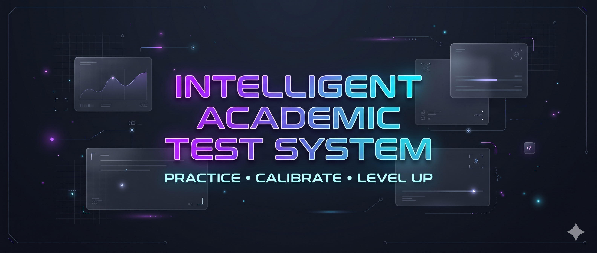

<div align="center">

  
</div>

  # 🎓 INTELLIGENT ACADEMIC TEST SYSTEM
  ### *Practise . Calibrate . Level Up*

 

 This is an Intelligent Academic Test System designed to facilitate the creation, administration, and evaluation of academic tests. The system leverages advanced algorithms and machine learning techniques to provide a seamless testing experience for both educators and students.

## Features
- **Test Creation**: System can easily create tests with various question types, including multiple choice, true/false, short answer, and essay questions.
- **Automated Grading**: The system automatically grades objective questions and provides instant feedback to students.
- **Adaptive Testing**: The system can adjust the difficulty of questions based on the student's performance, ensuring a personalized testing experience.
- **Analytics and Reporting**: Educators can access detailed analytics and reports on student performance, helping to identify areas for improvement.
- **Secure and Scalable**: The system is designed with security in mind, ensuring that student data is protected. It can also scale to accommodate a large number of users.

### Project Structure

```text
iats/
├── backend/                 # Flask REST API backend
│   ├── app/                 # Application factory, routes, controllers, models, schemas
│   ├── run.py               # Server startup entry point
│   └── README.md            # Backend setup and API documentation
├── repo_images/             # Assets and banners
├── CONTRIBUTING.md           # Contribution guidelines & code standards
├── LICENSE                  # Project license
└── README.md                # Project overview
```

---

## 🤝 Contributing

We welcome contributions! Please read our [Contributing Guidelines](CONTRIBUTING.md) to learn how to set up your local environment, follow our branch and commit conventions, and submit pull requests.

